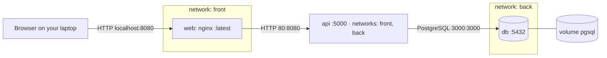

# Lab 4 · Multi-service app with Compose

GitHub user: elvenhope · Reference files used (Lab 2 fallback): no

<!-- Keep every heading as it is: the grader finds the sections by name. Fill in every blank (four underscores) and your GitHub user name: check.sh writeup flags anything left. -->

## 1 · Architecture



Which arrow crosses from your laptop into Docker: http localhost:8080

## 2 · Predictions and what happened

Part 1: fill in "I predicted" (the letter and a one-line reason) before you write any YAML. Part 3: fill in the rest. A wrong prediction that you explain earns full marks.

| # | I predicted | What I saw (command → the deciding output line) | Match? | If not: why |
|---|-------------|--------------------------------------------------|--------|-------------|
| P1 | __A I think it will return the IP of the container that does the DB__ | __It did return the ip a local one starting with 172 but still__ | __Yes__ | |
| P2 | __A I am assuming 5432 is the exposed port in that case yes__ | __It was not exposed__ | __No__ | Because the port was not exposed to the local machine |
| P3 | __B regular down doesn't remove volume only container and network__ | __The data survived the down__ | __Yes__ | |
| P4 | __B everything is gone, and only DB is started up__ | __it had to be rebuilt __ | __Yes__ | |
| P5 | __B I am assuming that API has a healthcheck built in that checks__ | __I was close, it had depends on, the healthcheck was in the database__ | __No__ | The healthcheck was in the db not in the API|
| P6 | __B browser doesn't know docker DNS__ | __the browser doesn't know api dns__ | __yes__ | |

## 3 · Backup and restore

```text
(paste the whole output of step 3.3: pg_dump, down -v, the count query, the restore, and the GET with your todo back)
davit@Davits-MacBook-Air-M4 turiba-devops-labs % mkdir -p backup
davit@Davits-MacBook-Air-M4 turiba-devops-labs % docker compose exec -T db pg_dump -U todo -d todo > backup/todo.sql

davit@Davits-MacBook-Air-M4 turiba-devops-labs % grep 'survive me' backup/todo.sql

3       elvenhope: survive me       f       2026-10-19 17:07:45.901169+00
davit@Davits-MacBook-Air-M4 turiba-devops-labs % docker compose down -v

[+] down 6/6
 ✔ Container course-app-web-1 Removed                                                                                    0.1s
 ✔ Container course-app-api-1 Removed                                                                                    0.1s
 ✔ Container course-app-db-1  Removed                                                                                    0.1s
 ✔ Volume course-app_pgdata   Removed                                                                                    0.0s
 ✔ Network course-app_back    Removed                                                                                    0.1s
 ✔ Network course-app_front   Removed                                                                                    0.0s
davit@Davits-MacBook-Air-M4 turiba-devops-labs % docker compose up -d --wait db

[+] up 3/3
 ✔ Network course-app_back   Created                                                                                     0.0s
 ✔ Volume course-app_pgdata  Created                                                                                     0.0s
 ✔ Container course-app-db-1 Healthy                                                                                     5.6s
davit@Davits-MacBook-Air-M4 turiba-devops-labs % docker compose exec db psql -U todo -d todo -c 'select count(*) from todos'

ERROR:  relation "todos" does not exist
LINE 1: select count(*) from todos
                             ^
davit@Davits-MacBook-Air-M4 turiba-devops-labs % docker compose exec -T db psql -U todo -d todo < backup/todo.sql

SET
SET
SET
SET
SET
SET
 set_config 
------------
 
(1 row)

SET
SET
SET
SET
SET
SET
CREATE TABLE
ALTER TABLE
CREATE SEQUENCE
ALTER SEQUENCE
ALTER SEQUENCE
ALTER TABLE
COPY 3
 setval 
--------
      3
(1 row)

ALTER TABLE
davit@Davits-MacBook-Air-M4 turiba-devops-labs % docker compose up -d --wait

[+] up 4/4
 ✔ Network course-app_front   Created                                                                                    0.0s
 ✔ Container course-app-db-1  Healthy                                                                                    1.2s
 ✔ Container course-app-api-1 Healthy                                                                                    5.7s
 ✔ Container course-app-web-1 Healthy                                                                                    1.2s
davit@Davits-MacBook-Air-M4 turiba-devops-labs % curl -s localhost:8080/api/todos
[{"id":1,"title":"cake","done":false,"created_at":"2026-10-19T17:00:22.023Z"},{"id":2,"title":"elvenhope: first","done":false,"created_at":"2026-10-19T17:00:32.319Z"},{"id":3,"title":"elvenhope: survive me","done":false,"created_at":"2026-10-19T17:07:45.901Z"}]%                                                                                                                         
davit@Davits-MacBook-Air-M4 turiba-devops-labs % 

```

Why the restore must run before `api` starts: __because api says if not exist create todos from scratch, and then restore would be like there's a duplicate table__

## 4 · Compose clinic

### c1 (worked example)
- Error line (copied): `connect ECONNREFUSED 127.0.0.1:5432`
- Checkpoint: port, inside `api`
- Fix: `DB_HOST: db`
- Why this fix, and not the tempting one: inside `api`, `localhost` is `api` itself, and nothing listens on 5432 there. Docker's DNS answers `db` with the database container's address. Publishing `db`'s port would "work" by opening a door into the database.
- Hints used: 0

### c2
- Committed fix: `lab4/clinic/c2/`
- Error line (copied): __Safari can’t open the page “‎localhost:8102” because Safari can’t connect to the server “localhost”.__
- Checkpoint (name / path / port / app / config / data): __port inside web__
- Fix: __ switch 3000 and 8102 positions__
- Why this fix, and not the tempting one: __i don't think there was another fix that came to my head__
- Hints used: __0__

### c3
- Committed fix: `lab4/clinic/c3/`
- Error line (copied): __the web wasn't able to find api since they were on diff networks__
- Checkpoint (name / path / port / app / config / data): __config the api only had back network__
- Fix: __make api have both front and back__
- Why this fix, and not the tempting one: __well api should have access to both web and db since its in the middle__
- Hints used: __0__


### c4
- Committed fix: `lab4/clinic/c4/`
- Error line (copied): __in the app.js API var was hardcoded to api:5000/api/todo__
- Checkpoint (name / path / port / app / config / data): __app__
- Fix: __changed API var to just /api/todo__
- Why this fix, and not the tempting one: __nginx already reverse proxies the /api/ to the proper path__
- Hints used: __0__

### c5
- Committed fix: `lab4/clinic/c5/`
- Error line (copied): __there was no volumes in compose.yml__
- Checkpoint (name / path / port / app / config / data): __config__
- Fix: __add volume pgdata, and assign it to the db__
- Why this fix, and not the tempting one: __this is the easiest way i know how to have persistent data__
- Hints used: __0__

### c6
- Committed fix: `lab4/clinic/c6/`
- Error line (copied): __ ✘ Container clinic-c6-db-1      Error dependency db failed to start   __
- Checkpoint (name / path / port / app / config / data): __config__
- Fix: __migrate had to have db as a depends on db being started healthy, and db needed a healthcheck__
- Why this fix, and not the tempting one: __proper health practices i guess__
- Hints used: __0__

### c7
- Committed fix: `lab4/clinic/c7/`
- Error line (copied): __env variable was wrong, in the env it was DB_PASSWORD, in config, DB_PASS__
- Checkpoint (name / path / port / app / config / data): __config__
- Fix: __changed DB_PASS to DB_PASSWORD__
- Why this fix, and not the tempting one: __well, i guess you could also change the env, but thats like harder__
- Hints used: __0__

### c8
- Committed fix: `lab4/clinic/c8/`
- Error line (copied): __db-1  | 2026-10-19 17:56:38.386 UTC [38] FATAL:  password authentication failed for user "todo"__
- Checkpoint (name / path / port / app / config / data): __data__
- Fix: __ manually update the postgress user password with a command docker compose exec db psql -U todo -d todo -c "ALTER USER todo WITH PASSWORD 'clinic-c8-new';"__
- Why this fix, and not the tempting one: __well, removing the volume would have fixed it but removed the todo business logic data__
- Hints used: __2__

## 5 · Run in one command

```bash
git clone https://github.com/elvenhope/turiba-devops-labs.git && cd turiba-devops-labs
cp .env.example .env
docker compose up -d --wait
```

## 6 · Answers

### A1
In c1 the API logged `ECONNREFUSED 127.0.0.1:5432`. Which container was `127.0.0.1`, and why does `db` work instead?

because 127.0.0.1 is the container localhost but the docker dns knows the service name as ip

### A2
Trace `POST /api/todos` from your browser to PostgreSQL: each hop, with the name and port used. Why does `db` have no `ports:`?

first it will reach nginx localhost on port 80 which will reverse proxy the /api/ part to the api:5000 inside docker.  db doesnt need ports since they are in the same network

### A3
`docker compose down` kept your todos, and `docker compose down -v` deleted them. Where were they stored, and what exactly does `-v` remove?

volumes

### A4
With `db` stopped, `docker compose ps` showed `api` as healthy, but `/api/todos` answered 500. Explain both. What does `service_healthy` protect against, and what not?

service healthy means something is "running" it doesnt mean its working as intended. the api was running as intended but the database was not therefore it had no where to fetch the data
