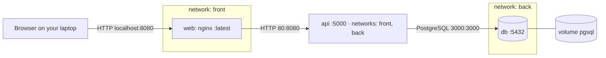

# Lab 4 · Multi-service app with Compose

GitHub user: elvenhope · Reference files used (Lab 2 fallback): no

<!-- Keep every heading as it is: the grader finds the sections by name. Fill in every blank (four underscores) and your GitHub user name: check.sh writeup flags anything left. -->

## 1 · Architecture



Which arrow crosses from your laptop into Docker: http localhost:8080

## 2 · Predictions and what happened

Part 1: fill in "I predicted" (the letter and a one-line reason) before you write any YAML. Part 3: fill in the rest. A wrong prediction that you explain earns full marks.

| # | I predicted | What I saw (command → the deciding output line) | Match? | If not: why |
|---|-------------|--------------------------------------------------|--------|-------------|
| P1 | __A I think it will return the IP of the container that does the DB__ | ____ | ____ | |
| P2 | __A I am assuming 5432 is the exposed port in that case yes__ | ____ | ____ | |
| P3 | __B regular down doesn't remove volume only container and network__ | ____ | ____ | |
| P4 | __B everything is gone, and only DB is started up__ | ____ | ____ | |
| P5 | __B I am assuming that API has a healthcheck built in that checks__ | ____ | ____ | |
| P6 | __B browser doesn't know docker DNS__ | ____ | ____ | |

## 3 · Backup and restore

```text
(paste the whole output of step 3.3: pg_dump, down -v, the count query, the restore, and the GET with your todo back)
```

Why the restore must run before `api` starts: ____

## 4 · Compose clinic

### c1 (worked example)
- Error line (copied): `connect ECONNREFUSED 127.0.0.1:5432`
- Checkpoint: port, inside `api`
- Fix: `DB_HOST: db`
- Why this fix, and not the tempting one: inside `api`, `localhost` is `api` itself, and nothing listens on 5432 there. Docker's DNS answers `db` with the database container's address. Publishing `db`'s port would "work" by opening a door into the database.
- Hints used: 0

<!-- Copy the block below once for every mission you solved and change cN to c2, c3 … Then delete the cN block itself. -->

### cN
- Committed fix: `lab4/clinic/cN/`
- Error line (copied): ____
- Checkpoint (name / path / port / app / config / data): ____
- Fix: ____
- Why this fix, and not the tempting one: ____
- Hints used: ____

## 5 · Run in one command

```bash
git clone https://github.com/<you>/turiba-devops-labs.git && cd turiba-devops-labs
____
____
```

## 6 · Answers

### A1
In c1 the API logged `ECONNREFUSED 127.0.0.1:5432`. Which container was `127.0.0.1`, and why does `db` work instead?

____

### A2
Trace `POST /api/todos` from your browser to PostgreSQL: each hop, with the name and port used. Why does `db` have no `ports:`?

____

### A3
`docker compose down` kept your todos, and `docker compose down -v` deleted them. Where were they stored, and what exactly does `-v` remove?

____

### A4
With `db` stopped, `docker compose ps` showed `api` as healthy, but `/api/todos` answered 500. Explain both. What does `service_healthy` protect against, and what not?

____
